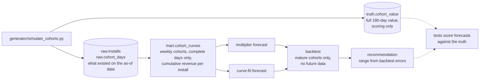

# Game LTV & ROAS Forecasting

[](https://github.com/Saigwe/game-ltv-roas-forecasting/actions/workflows/ci.yml)

> Forecast what a mobile game's acquisition cohorts will be worth at day 180 from their first 7, 14 or 30 days, backtest the forecast without leakage, and turn it into a scale / hold / cut decision per channel. Built to catch the classic trap: the channel with the best day-7 ROAS is the worst investment.

**Author:** Stanley Igwe, Lead Data (Analytics) Engineer · [Portfolio](https://saigwe.github.io)
**Stack:** Python · DuckDB SQL · pandas · NumPy · pytest · GitHub Actions
**Data:** fully synthetic. The generator invents every cohort, cost and dollar of revenue. No real game, studio or campaign data is used.

---

## 90-second summary
| | |
|---|---|
| **Problem** | User acquisition budgets are set weeks after install, but a player's value takes months to show. Teams fall back on early ROAS, which rewards channels whose players spend fast and leave. |
| **What I built** | Weekly cohort curves in DuckDB that only keep fully observed days. Two forecasting methods. A backtest that only lets each forecast see what existed on its day k. A recommendation whose range comes from the backtest's own errors. Generated truth, kept apart from the data, to score it all. |
| **Why it matters** | Spend moves to channels that pay back over the player's life, with an honest range around each forecast, not a single confident number. |
| **Proof** | From day 30 the forecast is within 2 to 11% on average (backtest MAPE), every 90% range contains the real 180-day ROAS, and the channel ranking matches the truth. Day-7 ROAS ranks the channels backwards. 11 pytest tests. See [results](results/results.md). |

## The trap, in one table (day-30 recommendation)
| Channel | CPI | D7 ROAS | D180 ROAS forecast (90% range) | Actual D180 ROAS | Decision |
|---|---|---|---|---|---|
| rewarded_network | $0.90 | **0.34** (best) | 0.61 (0.59 to 0.64) | 0.61 (worst) | **cut** |
| paid_social | $2.36 | 0.06 | 0.83 (0.69 to 1.04) | 0.79 | hold |
| paid_video | $3.14 | 0.05 (worst) | 1.05 (0.83 to 1.23) | 1.20 (best) | hold |

rewarded_network players earn quickly from ads and leave within days. paid_video players start slowly and keep paying, and it is the only channel that pays back (forecast payback on day 163). It stays on hold because the low end of its range is still under 1.0: the rule scales a channel only when even the low end pays back.

## Method

- **Cohort curves:** one weekly cohort per channel. A day is kept only once every install in the week has reached it, so a young cohort never looks worse because of partial days.
- **Multiplier method:** cumulative revenue per install at day k, times the median growth from day k to day 180 across the eight newest cohorts of the same channel that were already 180 days old *on the forecast date*.
- **Curve-fit method:** a power law fitted to the cohort's own first k days, extrapolated to day 180.
- **Backtest:** both methods on every cohort whose real 180-day value is known, for k = 7, 14 and 30.
- **Range and decision:** the forecast is adjusted by the 5th and 95th percentiles of that channel's backtest errors at that k. **Scale** if even the low end beats 1.0, **cut** if even the high end misses, otherwise **hold**.

## Backtest (multiplier vs curve fit, mean absolute % error)
| Channel | k = 7 | k = 14 | k = 30 |
|---|---|---|---|
| paid_social | 19.0% vs 125% | 14.2% vs 184% | 11.2% vs 181% |
| paid_video | 23.0% vs 59% | 23.2% vs 74% | 11.3% vs 119% |
| rewarded_network | 3.8% vs 184% | 3.7% vs 138% | 2.3% vs 89% |

The curve fit looks reasonable and is wrong by 60 to 180%. Revenue climbs fastest in the first days, so a curve fitted to them keeps climbing long after real players have left. The backtest is what shows this, which is why it decides the method rather than an assumption.

## Honest limits
- **Day 14 is too early for a slow-burn channel.** From day 14 the paid_video range tops out at 1.08 while the real value is 1.12. From day 30 every range contains the real value.
- **The range is built from per-cohort errors**, which are wider than the error on eight cohorts pooled, so it is deliberately conservative.
- **No seasonality or creative changes** are modelled. A real version would refresh the reference cohorts as the mix changes and watch for drift in the backtest error.

## Run it
```bash
pip install -r requirements.txt
make test    # 11 pytest tests, including scoring against the held-out truth
make all     # generate 80 weeks of cohorts -> results/results.md
```

## Tests
- **Units:** the curve fit recovers an exact power law; reference cohorts never include one that was not yet 180 days old on the forecast date; the multiplier is 1 at day k and grows.
- **Data:** cohort curves only hold complete days; cumulative revenue never falls; day-0 revenue per install matches the raw table.
- **Backtest:** only mature cohorts are scored; the multiplier beats the curve fit for every channel and k; day-30 error under 15%.
- **Against the truth:** day-7 ROAS would pick rewarded_network; the forecast ranks channels exactly as the truth does; forecasts within 15% of actual and every day-30 range contains it; rewarded_network is cut.
